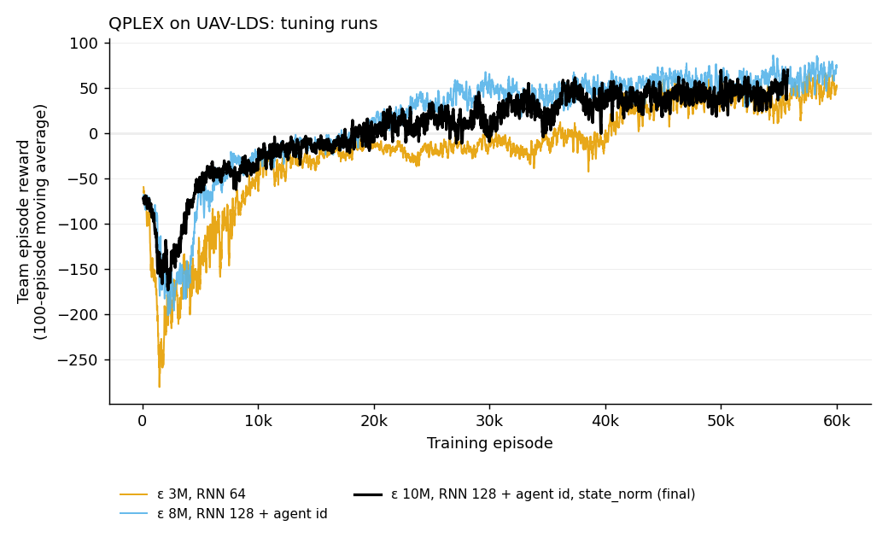
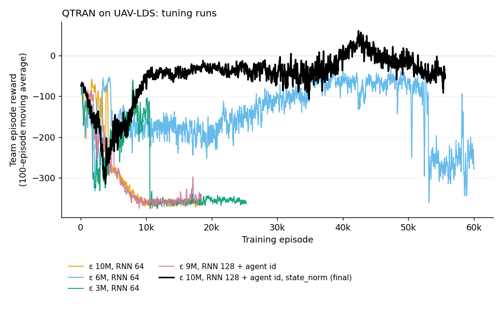
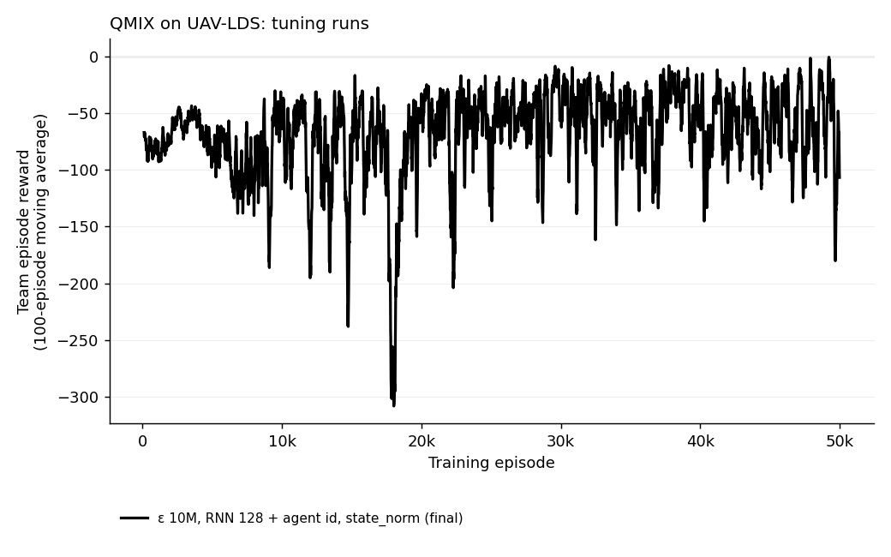
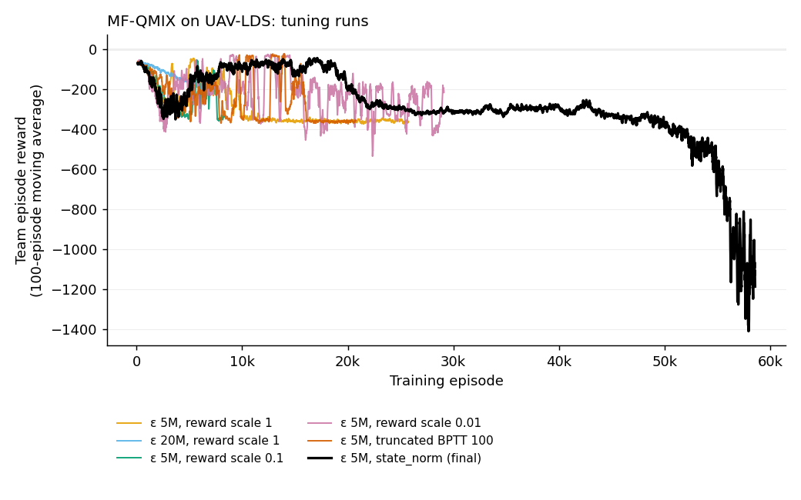
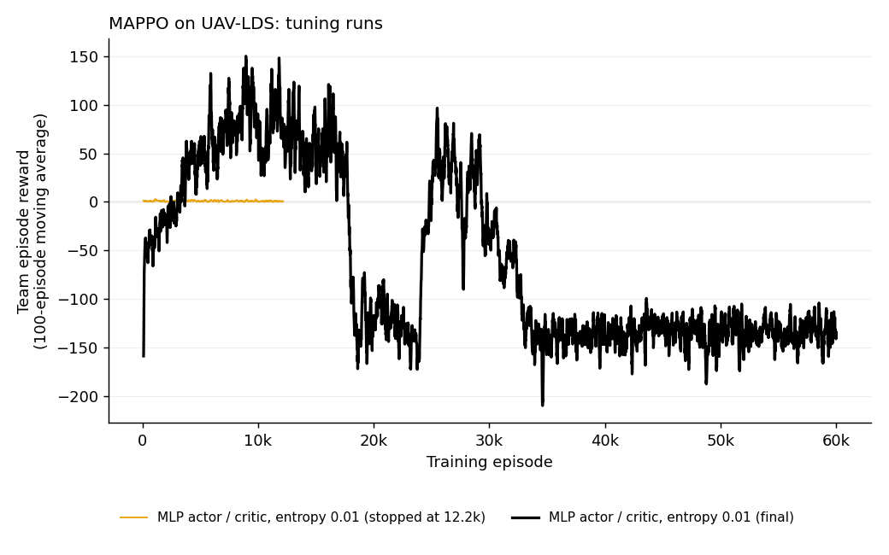

# Tuning of the UAV-LDS baselines

The value-decomposition baselines (QMIX, MF-QMIX, QPLEX, QTRAN) and MAPPO were tuned on UAV-LDS before the final
runs. This note lists the configurations that were trained and how they did.

- **Training metrics:** 100-episode moving averages over the training run. R is the episode team reward, SR is
  small + 2 × big deliveries.
- **AS:** 100-episode evaluation of the best checkpoint, with the protocol of `evaluate.py`. The Q family is
  evaluated greedily and MAPPO stochastically.
- **Figures:** the training reward of every configuration (100-episode moving average; the final setting in black).
  The plotted values are in `tuning/reward_curves.csv`. Runs shorter than 100 episodes are listed in the tables only.
- **Fixed in every run:**
  - Q family: lr 5e-4 (RMSprop), γ 0.99, replay buffer 1,000 episodes, batch 32, hard target update every 200
    episodes, double Q, ε 1.0 → 0.05 (linear).
  - MAPPO: lr 5e-4 (actor and critic), 10 PPO epochs, 1 mini-batch, clip 0.2, GAE 0.95, value normalisation,
    Huber loss δ 10, hidden 128 × 2.

## QPLEX

| ε anneal (steps) | state_norm | RNN / mixing / hypernet | Agent id | Episodes | Best R | Best SR | AS |
|---|---|---|---|---|---|---|---|
| 10M | off | 64 / 32 / 64 | no | ≤ 31 (5 starts, stopped) | – | – | – |
| 10M | off | 64 / 32 / 64 | no | 18.5k (stopped) | −56.3 | – | – |
| 6M | off | 64 / 32 / 64 | no | 60k | −32.2 | – | 0.00 |
| 3M | off | 64 / 32 / 64 | no | 0 (stopped at start) | – | – | – |
| 3M | off | 64 / 32 / 64 | no | 25.3k (stopped) | −59.7 | – | 0.00 |
| 9M | off | 128 / 64 / 128 | yes | 18.5k (stopped) | −64.3 | – | 0.00 |
| 10M | on | 128 / 64 / 128 | yes | 70 (stopped, restarted as the next run) | – | – | – |
| **10M** | **on** | **128 / 64 / 128** | **yes** | 55.6k | **63.2** | **1.34** | **1.24** |

## QTRAN

| ε anneal (steps) | state_norm | RNN / mixing | Agent id | Episodes | Best R | Best SR | AS |
|---|---|---|---|---|---|---|---|
| 3M | off | 64 / 64 | no | 60k | 69.0 | – | 0.28 |
| 8M | off | 128 / 128 | yes | 60k | 86.7 | – | 0.43 |
| 10M | on | 128 / 128 | yes | 70 (stopped, restarted as the next run) | – | – | – |
| **10M** | **on** | **128 / 128** | **yes** | 55.8k | 71.0 | **0.61** | **0.59** |

## QMIX

| ε anneal (steps) | state_norm | RNN / mixing | Agent id | Episodes | Best R | Best SR | AS |
|---|---|---|---|---|---|---|---|
| 10M | off | 128 / 64 | yes | 25.3k (stopped) | – | – | – |
| **10M** | **on** | **128 / 64** | **yes** | 50k | **1.8** | **0.23** | **0.28** |

The first configuration (without state_norm) has no saved training log, so only the final run is plotted.

## MF-QMIX

RNN 128, mixing 64, hypernet 256, agent id. Every configuration diverged after ε reached its floor (TD loss and
gradient norms up to 10⁷, reward collapse). Reward scaling, state normalisation, truncated back-propagation through
time and a soft target update were tried against this.

| ε anneal (steps) | Reward scale | state_norm | Other | Episodes | Best R | Best SR | AS |
|---|---|---|---|---|---|---|---|
| 10M | 1 | off | mixing 32, hypernet 128 | 31 (test, stopped) | – | – | – |
| 30M | 1 | off | mixing 32, hypernet 128 | 10 (test, stopped) | – | – | – |
| 5M | 1 | off | – | 25.7k (stopped) | −45.7 | 0.04 | 0.00 |
| 20M | 1 | off | – | 6.6k (stopped) | −57.6 | 0.03 | 0.00 |
| 5M | 0.1 | off | – | 8.3k (stopped) | −54.1 | 0.02 | 0.00 |
| 5M | 0.01 | off | – | 29.1k (stopped) | −25.0 | 0.07 | 0.00 |
| 5M | 1 | off | truncated BPTT, 100 steps | 20.8k (stopped) | −23.5 | 0.06 | 0.00 |
| **5M** | **1** | **on** | – | 58.6k (stopped) | −42.5 | **0.08** | 0.00 |

Short diagnostic runs (70 episodes each) compared a control run, state_norm, a soft target update (τ = 0.005) and
truncated BPTT. state_norm gave the smallest loss, gradient norm and Q values (loss 59, gradient 3.4e3, Q_tot 19,
against 1,781 / 9.4e4 / 291 for truncated BPTT), so it was kept for the full run.

## MAPPO

| Actor / critic | Entropy coef. | Episodes | Best R | AS (stochastic) |
|---|---|---|---|---|
| MLP | 0.01 | 0 (9 starts, stopped within seconds) | – | – |
| MLP | 0.01 | 12.2k (stopped) | 3.2 | – |
| MLP | 0.01 | 79 (stopped) | – | – |
| **MLP** | **0.01** | 60k | **151.3** | **5.20** |

The MLP run peaked at about 9k episodes and then collapsed; the best checkpoint is kept by the
moving-average rule.

## Final settings

| Model | Setting |
|---|---|
| QMIX, QPLEX, QTRAN | ε annealed over 10M steps, normalised mixer state (`--state_norm`), RNN 128 with agent id |
| MF-QMIX | ε annealed over 5M steps, normalised mixer state, no reward scaling, RNN 128 |
| MAPPO | MLP actor and critic, entropy 0.01 |

These are the arguments in `models.py`.

What the logs show:
- Larger RNNs with an agent-id input, and a normalised mixer state, were what moved the value-decomposition models
  off zero.
- The remaining failure pattern is the same for all four: under ε-greedy exploration the large penalties (collision
  −10, dropped big parcel) outweigh the rare delivery rewards.
- The Q family also makes about one gradient update per episode, against about ten for the MAAC family.
